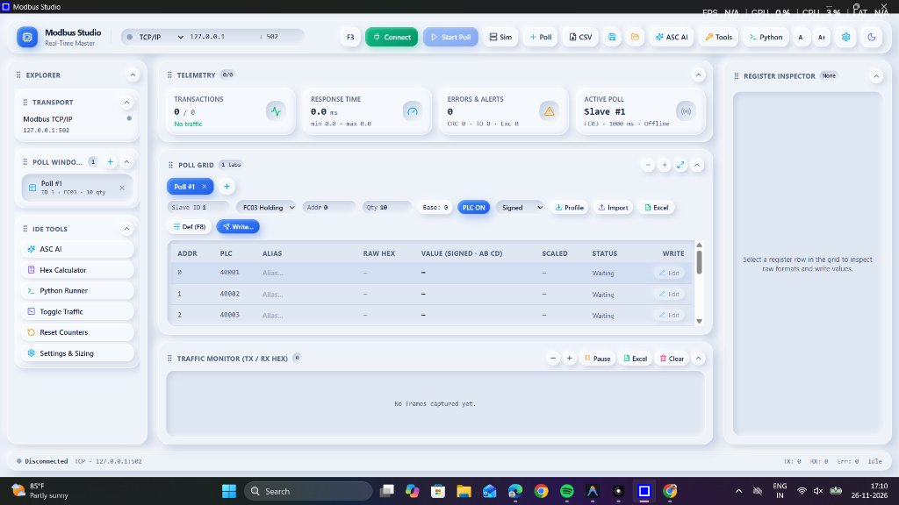

# Modbus Studio

Cross-platform **Modbus Master & Slave Simulator** desktop IDE built with **Rust**, **Tauri 2**, **React**, **TypeScript**, and **Tailwind CSS**.

[](https://github.com/sravanadi/modbus_industrial_commuincation/stargazers)
[](https://github.com/sravanadi/modbus_industrial_commuincation/network/members)
[](https://github.com/sravanadi/modbus_industrial_commuincation/graphs/contributors)
[](#license)



## Features

- **Transports:** Modbus **TCP/IP**, **RTU over TCP**, **UDP/IP**, **Serial RTU**, and **Serial ASCII** (`F3` Connection Setup, auto port detection, configurable baud/data bits/parity/stop bits, auto-reconnect).
- **Function Codes:** `01`–`04` (Read), `05`/`06`/`15`/`16`/`22` (Write & Mask Write), `07`/`08`/`17`/`43` (Diagnostics & Device ID), plus full `0x01`–`0x0B` exception decoding and CRC-16/LRC validation.
- **Virtualized Poll Grid (`K1`):** Multi-window round-robin polling up to 1000+ registers, `0/1`-based & `40001` PLC addressing, per-register aliases, scaling/units/alarms, `.mbprofile.json` templates, and **Excel (`.xls`)** / **CSV** export.
- **Display Formats & Bit Inspector:** Signed, Unsigned, Hex, Binary, `Int32`/`UInt32`/`Float32`/`Double64` with `AB CD`, `CD AB`, `BA DC`, `DC BA` byte/word swaps, and interactive 16-bit `FC22` toggle.
- **Engineering Tools:** Built-in TCP Slave Simulator with fault injection, Raw Hex Frame Sender, Serial Auto-Discover (`Baud × Parity × Slave ID`), Real-Time Trend Graph (PNG export), Hex & CRC-16/LRC Calculator, Python Runner, and **ASC AI** assistant (Local Ollama or Cloud/FreeLLM API).
- **Customizable Claymorphism IDE:** Light/Dark Clay themes, drag-and-drop container reordering, drag-to-resize docks, minimize/maximize Poll Grid, and `.mbproj` workspace save/load.

## Quick Start

```powershell
# 1. Install frontend dependencies
npm install

# 2. Run in development mode
npm run tauri dev

# 3. Build release binary / Windows installer
npm run tauri build
```

### Run Rust Protocol Tests

```powershell
cd src-tauri
cargo test
cargo clippy -- -D warnings
```

## Contributing

Contributions, issues, and feature requests are welcome!

1. Fork the repository
2. Create your feature branch (`git checkout -b feat/my-feature`)
3. Commit your changes (`git commit -m "Add my feature"`)
4. Push to the branch (`git push origin feat/my-feature`)
5. Open a Pull Request

[](https://github.com/sravanadi/modbus_industrial_commuincation/graphs/contributors)

## Star History

If **Modbus Studio** helps your industrial or embedded workflow, consider giving it a ⭐ on GitHub!

[](https://star-history.com/#sravanadi/modbus_industrial_commuincation&Date)

## License

Dual-licensed under **MIT** or **Apache-2.0**.
